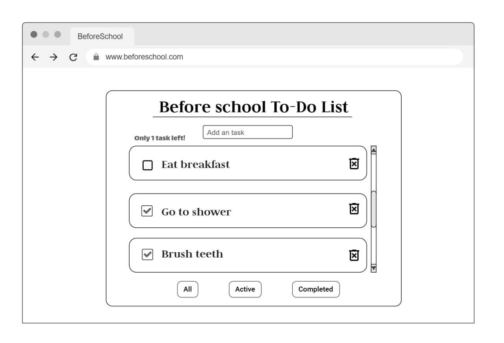
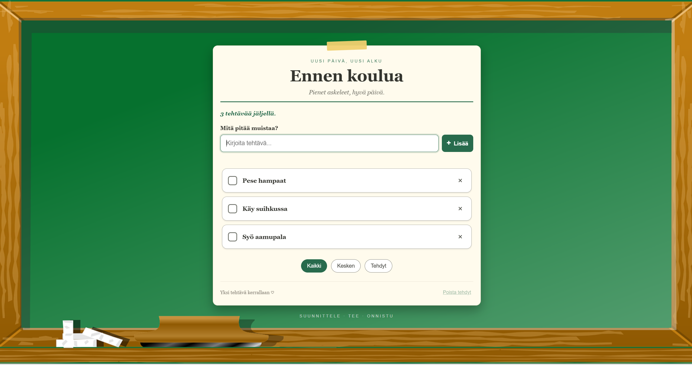

# Projektin nimi

**Tekijä(t):** Anniina Pitkänen ja Lisette Täks

## Projektisuunnitelma

### Projektin idea

Ideana oli tehdä lista, mihin voit lisätä asioita mitä sinun pitää tehdä ennen koulua. Eli "To-Do lista".

### Suunnitellut toiminnot

Listaa vähintään kolme sovellukseesi suunniteltua toimintoa:

- Voit lisätä tehtäviä hakupalkin avulla.
- Voit jaotella tehtävät mallilla: Kaikki tehtävät, keskeneräiset ja valmiit.
- Voit poistaa tehdyt tehtävät.

### Rautalankamalli / luonnos

## Verkkolinkit

- **Julkaistu sovellus:** [Lisää tähän GitHub Pages -osoite](https://yourusername.github.io/your-repository/)
- **GitHub-repositorio:** [Lisää tähän repositorion osoite](https://github.com/yourusername/your-repository)
- **Projektin videoesittely:** [Lisää tähän videon osoite](https://example.com/)

## Tietoja sovelluksesta

**ToDo(ennen koulua)** on verkkosovellus, joka toimii listana, mitä kaikkea sinun pitää tehdä ennen kouluun lähtöä.

Sovelluksessa voit listata kaikki asiat jotka sinun on tehtävä ennen koulua, eli se toimii To-Do listana koululaiselle.

## Teknologiat

Kuvaile, mitä teknologioita käytit ja mikä niiden rooli oli projektissasi.

- HTML – sivun rakenne
- CSS – Käytin CSS:ää sivun ulkoasun ja asettelun suunnitteluun. Sen avulla toteutin sovelluksen värit, taustakuvan, painikkeiden tyylit, tehtävien ulkoasun ja responsiivisuuden eri kokoisilla näytöillä.
- JavaScript – toiminnallisuus, DOM-skriptaus ja lomakkeiden validointi
- localStorage – tietojen tallentaminen selaimeen

## Sovelluksen käyttö

1. Avaa julkaistu sovellus GitHub Pages -linkistä.
2. Kirjoita tehtävä tekstikenttään ja paina Lisää tehtävä -painiketta.
3. Merkitse tehtävä tehdyksi valintaruudusta tai poista se rastipainikkeella (×).
4. Suodata tehtäviä valitsemalla Kaikki, Kesken tai Tehdyt.
5. Voit poistaa kaikki valmiit tehtävät painamalla Poista tehdyt -painiketta.
6. Päivitä sivu ja tarkista, että tehtävät ja niiden tila säilyvät selaimessa.

## Sovelluksen käynnistäminen paikallisesti

1. Kloonaa repositorio GitHubista tai lataa se omalle koneellesi ZIP-tiedostona.
2. Avaa ladattu projektikansio.
3. Varmista, että index.html, CSS-tiedosto, JavaScript-tiedosto ja images-kansio ovat oikeissa paikoissa.
4. Avaa index.html selaimessa. Voit myös käyttää Visual Studio Coden Live Server -laajennusta.
5. Käytä sovellusta selaimessa. Tehtävät tallennetaan selaimen paikalliseen tallennustilaan.

## Kuvakaappaukset

Lisää tähän vähintään yksi kuvakaappaus toimivasta sovelluksestasi.

Esimerkki kuvan lisäämisestä:

**Ei tunnettuja virheitä.**

## Työn jakautuminen

- Anniina Pitkänen: Tein rautalankamallin moqups nettisivulla ja keskityin sovelluksen visuaalisuuteen, tein styles.css koodin ja valitsin kuvan nettisivulle.
- Lisette Täks: Teki sivun index.html tiedoston, sekä script.js tiedoston.

Yhdessä ideoimme ja suunnittelimme sovelluksen ja kävimme koodit läpi ennen palautusta, sekä täydensimme toistemme koodeja.

## Oma arvio ja oppimisen reflektointi

Pohdi työtäsi ja oppimisprosessiasi.

- Mielestäni onnistuin visuaalisesti oikein hyvin, sovelluksen väreistä ja ulkonäöstä huomaa, että se on selvästi koululaisille tarkoitettu.
- Haastavaa oli tehdä yhdessä koodia, sillä koodit toimivat kuitenkin yhtenäisesti. Ilman html tiedostoa en voinut katsoa miltä sovellus näyttää visuaalisesti, vaan piti tehdä css koodi ns. mielikuvituksella ja muokata sitten koodia, kun html tiedosto oli valmis. Hankaluutta toi myös työnjako, sillä oli hankala saada työ jaettua tasavertoisesti. Nyt minulle tuli ehkä enemmän ns UI puolta, kun Lisetelle UX. Toki kävimme myös lopussa yhdessä koodin läpi ja lisäsimme muokkauksia, mutta päälinpuolisesti meni noin.
- Nämä oli aika tuttuja itselle aikasempien kurssien perusteella, esim W3.org nettisivusto oli ennestään tuttu ja sitä käytinkin nettisivun fonttien valinnassa.
- Oma arvio projektista: **10/10 pistettä**

## Lähteet ja kiitokset

Listaa kaikki projektissa käyttämäsi lähteet, tutoriaalit, kuvat ja koodiesimerkit.

- [Lähteen tai tutoriaalin nimi](https://www.w3.org/Style/Examples/007/fonts.en.html , https://www.w3.org/Style/CSS/)

- [Kuvalähde](https://www.needpix.com/photo/download/177598/green-blackboard-chalk-eraser-learn-school-free-vector-graphics-free-pictures-free-photos)

- Käytetty tekoälytyökalu: Claude.Ai
  - Miten työkalua käytettiin: Käytin Claudea koodin virheiden lukuun ja kysyin myös claudelta olisiko hänellä ideoita mitä lisätä visuaalisuuteen ja hän keksi tuon teipinpalan. Olisin itse halunnut, että se olisi näyttänyt liitutaulun tekstiltä, mutta se näytti niin sekavalta joten kysyin claudelta apua ja hän ehdotti teipinpalaa. 

  Koodi:
  .tape {
  position: absolute;
  top: -11px;
  left: 50%;

  transform: translateX(-50%) rotate(-2deg);

  width: 98px;
  height: 22px;

  background: #f0cf70;
  opacity: 0.95;
  border-radius: 2px;
}

  ## Lisenssi

Tämä projekti on lisensoitu MIT-lisenssillä.

Lisätietoa lisenssin lisäämisestä GitHub-projektiin:
https://docs.github.com/en/communities/setting-up-your-project-for-healthy-contributions/adding-a-license-to-a-repository
